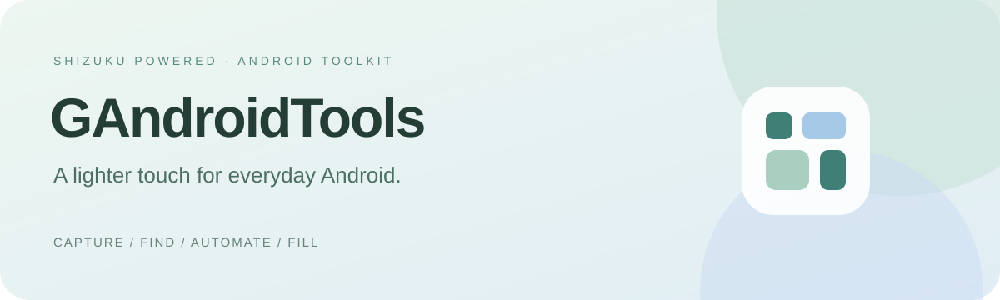

<a href="README.md">简体中文</a> · <a href="README.en.md">English</a>

  
  
  
  

<b>A fresh, configurable Android toolbox powered by Shizuku.</b> Keep capture, search, automation and text snippets within reach at the edge of your screen.

<a href="https://github.com/z2bguoguo/GAndroidTools/releases">Preview downloads</a> · <a href="https://z2bguoguo.github.io/GAndroidTools/en/">Documentation</a> · <a href="docs/en/guide/start.md">Get started</a> · <a href="https://github.com/z2bguoguo/GAndroidTools/issues">Report an issue</a>

### Tools within reach

| Tool | What it does |
| --- | --- |
| **Super background** | Move running tasks to independent virtual displays and restore them from task cards. |
| **Screenshot** | Freeze pixels and control metadata, then edit control visibility in an overlay; includes a delay wheel. |
| **Long capture** | Page jumps, smooth swipes and manual frames; select control regions, mask exclusions, match overlaps, split tall exports and auto-save to the gallery. |
| **Super find** | Find text in accessible controls, scroll to matches and briefly highlight them. |
| **Accessibility manager** | Manage installed accessibility services and re-enable selected services when their enabled setting is removed. |
| **Super macros** | Explicitly record control actions, then edit, import and run JavaScript automation. |
| **Page snapshot** | Export a screenshot and control metadata as a `.gatpage` archive readable by ZIP tools. |
| **Information notebook** | Nested folders, quick filling, deferred input, encrypted private snippets and live MFA codes. |
| **Terminal logs** | Live output, severity and keyword filters, pause, follow mode and rotating log export. |
| **Automatic updates** | Periodic checks, download progress and verification of the file and original signing identity before Android installation. |

### Made for everyday use

- Rounded cards in mint and mist blue, with Chinese and English interfaces.
- Single and long captures share expandable control trees, readable control types and nearby multi-selection on hold; hidden regions export with PNG alpha.
- Layered page packs retain window buffers, controls and labeled crops; long captures deduplicate fixed bars and repair overlays from real aligned frames.
- An inward-facing semicircle supports hold-and-drag direction selection, tap-then-drag movement, docking and a custom double tap.
- Assign five action balls and the center double tap visually. Eight settings categories include detailed bilingual help and examples.
- Private snippets and MFA secrets use Android Keystore encryption with strong biometric verification for each access.
- Information and scripts stay local. No analytics SDK or page-content upload.

### Get started

Install a preview, start [Shizuku](https://shizuku.rikka.app/), authorize the connection on Home and grant overlay permission. The optional toolbox accessibility service enables input and control recording. Switch to the target app before opening a floating tool.

This is preview software. Task migration and control automation depend on Android, device firmware and the target application. Virtual displays cannot guarantee that processes remain alive. Protected content and custom controls without accessible metadata may be unavailable. See [compatibility and validation](docs/en/guide/compatibility.md).

### Documentation and contributions

[User guide](docs/en/guide/start.md) · [Script API](docs/en/guide/macros.md) · [Page format](docs/en/guide/page-format.md) · [Build and release](docs/en/development/build.md) · [Contributing](CONTRIBUTING.md) · [Security](SECURITY.md)

Licensed under the [GNU GPL v3 or later](LICENSE). See [third-party notices](THIRD_PARTY_NOTICES.md).
